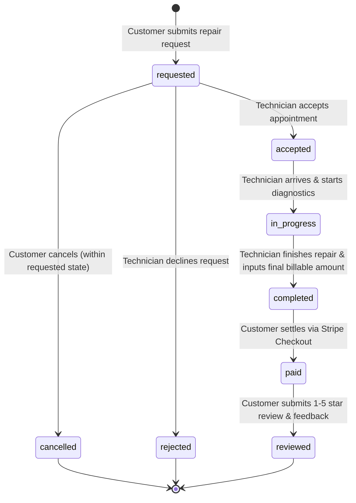

# ⚡ FixMate — Backend RESTful API & Payment Engine

<div align="center">

[](https://fix-mate-server-teal.vercel.app/)
[](https://fix-mate-flame.vercel.app/)
[](https://nodejs.org/)
[](https://expressjs.com/)
[](https://www.mongodb.com/)
[](https://stripe.com/)
[-success?style=for-the-badge&logo=node.js&logoColor=white)](https://nodejs.org/api/test.html)
[](LICENSE)

**High-performance, secure, and resilient RESTful API engine powering the FixMate on-demand repair service marketplace.**

[Live API Health](https://fix-mate-server-teal.vercel.app/health) • [Frontend Web App](https://fix-mate-flame.vercel.app/) • [Client Repository](https://github.com/CodeWithTanim/FixMate)

</div>

---

## 🌟 Executive Summary

The **FixMate Server** is a robust Node.js & Express RESTful API engineered with a single-file, zero-bloat architecture (`index.js`). It manages complex marketplace business logic including:
- An **immutable repair booking state machine** with optimistic concurrency control.
- **Pay-After-Completion Stripe settlement** with raw-body cryptographic webhook verification.
- **Technician Pro Subscription engine** ($29/month) handling recurring billing, commission recalculation, and invoice reconciliation.
- **Strict Role-Based Access Control (RBAC)** across Customers, Technicians, and Administrators via HS256 JWT tokens.

---

## 🚀 Live Endpoints

| Resource | URL | Status | Description |
| :--- | :--- | :---: | :--- |
| **Production API Root** | [https://fix-mate-server-teal.vercel.app/](https://fix-mate-server-teal.vercel.app/) |  | API identification and version status |
| **Liveness Probe** | [https://fix-mate-server-teal.vercel.app/health](https://fix-mate-server-teal.vercel.app/health) |  | Fast health check (independent of database) |
| **Readiness Probe** | [https://fix-mate-server-teal.vercel.app/health/ready](https://fix-mate-server-teal.vercel.app/health/ready) |  | Deep check with DB ping latency & memory statistics |
| **Companion Frontend** | [https://fix-mate-flame.vercel.app/](https://fix-mate-flame.vercel.app/) |  | Next.js 16 production web application |

---

## ⚡ Key Engineering & Backend Highlights

- **Consolidated Single-Module Architecture**: Built cleanly in `index.js` (~3,500 lines) following micro-kernel patterns, avoiding directory fragmentation while strictly separating concerns via pure domain functions.
- **Cryptographic Webhook Ingestion**: Ingests Stripe webhook payloads with unparsed raw buffer verification (`stripe.webhooks.constructEvent`), preventing replay attacks and payload tampering.
- **Double-Fulfillment & Race Prevention**: Idempotency checks guarantee that network retries or simultaneous webhooks and client redirects never double-credit payments or distort financial ledgers.
- **Active Booking Conflict Guard**: Enforces database-level consistency preventing customers from placing multiple active bookings for the same service before prior work is completed or cancelled.
- **Strict Test-Mode Invariant**: Production code actively blocks livemode Stripe keys (`sk_live_`) and rejects livemode sessions, eliminating catastrophic test leakage in evaluation environments.
- **Zero-Downtime Database Indexing**: Auto-initializes optimized compound and unique indexes on MongoDB startup (`email`, `fixtureKey`, `stripeSessionId`, active booking constraints).

---

## 🔄 Repair Lifecycle State Machine



### State Machine Transition Rules
1. **`requested`**: Initial state created upon booking submission. Customer can cancel; technician can accept or reject.
2. **`accepted`**: Technician committed to the repair. Customer cancellation locked.
3. **`in-progress`**: Technician on-site. Problem diagnostics and parts replacement underway.
4. **`completed`**: Repair concluded. **Technician must provide the verified final amount** (minimum $0.50 USD). Unpaid invoice generated.
5. **`paid`**: Stripe Checkout completes. Funds captured, technician payout recorded (0% fee for Pro, 10% fee for Standard), receipt generated.

---

## 📡 RESTful API Reference

### 1. System & Public Endpoints
| Method | Endpoint | Access | Description |
| :--- | :--- | :--- | :--- |
| `GET` | `/` | Public | Service metadata and version banner |
| `GET` | `/health` | Public | High-speed uptime liveness probe |
| `GET` | `/health/ready` | Public | Deep readiness check with MongoDB round-trip latency |
| `GET` | `/api/services` | Public | Paginated service catalog with search, category & mode filters |
| `GET` | `/api/services/:id` | Public | Detailed view of an approved, active repair service |

### 2. User & Authentication
| Method | Endpoint | Access | Description |
| :--- | :--- | :--- | :--- |
| `GET` | `/api/me` | Authenticated | Current authenticated user profile projection |
| `PATCH` | `/api/users/profile` | Authenticated | Update user name, phone number, bio, and service area |
| `POST` | `/api/upload` | Authenticated | Secure image upload with magic-byte validation |

### 3. Technician Service Catalog
| Method | Endpoint | Access | Description |
| :--- | :--- | :--- | :--- |
| `POST` | `/api/services` | Technician | Create repair service (enforces max 5 for standard tier, unlimited for Pro) |
| `GET` | `/api/services-my` | Technician | View owned services across all statuses (`approved`, `pending`, `rejected`) |
| `PATCH` | `/api/services/:id` | Technician | Update service details (triggers re-moderation) |
| `PATCH` | `/api/services/:id/availability` | Technician | Toggle service listing visibility on/off |
| `DELETE` | `/api/services/:id` | Technician | Permanently delete owned service listing |

### 4. Booking & Job Lifecycle
| Method | Endpoint | Access | Description |
| :--- | :--- | :--- | :--- |
| `POST` | `/api/bookings` | Customer | Create booking request with duplicate active request check |
| `GET` | `/api/bookings/my` | Customer | List customer repair bookings with full status history audit trail |
| `PATCH` | `/api/bookings/:id/cancel` | Customer | Cancel booking (strictly permitted while in `requested` status) |
| `GET` | `/api/bookings/technician` | Technician | Incoming technician repair queue |
| `PATCH` | `/api/bookings/:id/status` | Technician | Advance state machine (`accepted`, `rejected`, `in-progress`, `completed`) |

### 5. Stripe Payments & Billing
| Method | Endpoint | Access | Description |
| :--- | :--- | :--- | :--- |
| `POST` | `/api/payments/create-checkout-session` | Customer | Initialize Stripe Checkout session for completed repair |
| `GET` | `/api/payments/verify` | Customer | Synchronously verify checkout completion & reconcile booking |
| `POST` | `/api/payments/webhook` | Stripe Webhook | Raw-body cryptographically verified webhook handler |
| `GET` | `/api/payments/my` | Customer | Customer payment receipts and transaction records |
| `POST` | `/api/subscriptions/create-checkout-session` | Technician | Initiate $29/mo Pro membership subscription |
| `GET` | `/api/subscriptions/verify` | Technician | Verify and activate Pro membership with 0% commission tier |

### 6. Administration & Governance
| Method | Endpoint | Access | Description |
| :--- | :--- | :--- | :--- |
| `GET` | `/api/admin/services` | Admin | Review pending technician service listings |
| `PATCH` | `/api/admin/services/:id/approval` | Admin | Approve or reject submitted service listings |
| `GET` | `/api/admin/bookings` | Admin | System-wide booking surveillance across all users |
| `GET` | `/api/admin/users` | Admin | Search and inspect all registered accounts |
| `PATCH` | `/api/admin/users/:id/role` | Admin | Upgrade/downgrade roles (with admin self-demotion block) |
| `GET` | `/api/admin/payments` | Admin | Master transaction ledger, gross volume & net commission |
| `GET` | `/api/stats/admin` | Admin | Executive metrics dashboard statistics |

---

## 🔑 Demo Accounts for Evaluation

The following demo accounts are configured for evaluation and multi-role testing:

| Role | Email | Service Domain / Area | Features to Test |
| :--- | :--- | :--- | :--- |
| **Platform Admin** | `admin@fixmate.dev` | Full Platform Oversight | Moderation queue, user role management, transaction ledger |
| **Technician 1** | `rahim.tech@fixmate.dev` | Smartphones & Laptops (Dhaka Central) | Request queue, status transition, adding new repair services |
| **Technician 2** | `sarah.appliances@fixmate.dev` | HVAC & Refrigerators (Banani/Gulshan) | Active bookings, completing jobs with final billing |
| **Customer** | `customer@fixmate.dev` | Residential Client | Book service, track timeline, test Stripe checkout, leave review |

> **Password**: Demo account passwords can be set during local database seeding via `DEMO_USER_PASSWORD` or obtained securely via private evaluation handoff.

---

## 📂 Repository Structure

```text
FixMate-Server/
├── index.js             # Consolidated Express server, routes, middleware, Stripe handlers & DB
├── test/
│   └── server.test.js   # Automated integration test suite (11 test suites, 100% passing)
├── package.json         # Node.js configuration, dependencies and scripts
├── .gitignore           # Git ignore rules (strictly excludes .env files)
└── .vercelignore        # Vercel serverless deployment exclusions
```

---

## 🧪 Testing & Verification

The server includes a robust integration and domain verification suite built on Node.js native test runner:

```bash
# Run syntax and static validation
npm run check

# Run automated integration test suite (11 tests)
npm test
```

### Verified Test Cases
- ✅ **USD Gateway Thresholds**: Rejects negative, zero, non-numeric, or fractional-cent payment amounts.
- ✅ **Dhaka Calendar Engine**: Validates `YYYY-MM-DD` scheduling against past days in the explicit `Asia/Dhaka` timezone.
- ✅ **Payment Fulfillment Security**: Rejects uncompleted bookings, customer email mismatches, and amount discrepancies.
- ✅ **Stripe Livemode Protection**: Strictly blocks livemode Stripe keys and livemode sessions in test environments.
- ✅ **Pro Subscription Fulfillment**: Verifies $29.00 integer amount, binds customer ID, and activates Pro tier idempotently.
- ✅ **Invoice Webhook Reconciliation**: Idempotently records recurring invoice renewals and ignores stale failed invoices.
- ✅ **Integer Review Ratings**: Enforces 1–5 integer ratings and rejects non-integer/out-of-bounds ratings.
- ✅ **Checkout Generation Consistency**: Guarantees generation counter increments to prevent replay of cancelled checkouts.
- ✅ **Duplicate Active Booking Guard**: Returns HTTP 409 Conflict when a duplicate active booking is submitted.

---

## 💻 Local Development Setup

### 1. Prerequisites
- Node.js 20+
- MongoDB instance (local or MongoDB Atlas)
- Stripe Account (Test Mode API Keys)

### 2. Clone & Install
```bash
git clone https://github.com/CodeWithTanim/FixMate-Server.git
cd FixMate-Server
npm install
```

### 3. Configure Environment Variables
Create a private `.env` file in the root directory:

```env
# Server Configuration
PORT=5000
NODE_ENV=development

# Database
MONGODB_URI=mongodb+srv://<username>:<password>@cluster.mongodb.net/fixmate-db?retryWrites=true&w=majority
MONGODB_DBNAME=fixmate-db

# Cross-Origin Resource Sharing (CORS)
CORS_ORIGINS=http://localhost:3000,https://fix-mate-flame.vercel.app

# Security & Authorization (Shared with Next.js Client)
JWT_SECRET=your_shared_jwt_secret_with_express_backend_min_32_chars
JWT_ISSUER=http://localhost:3000
JWT_AUDIENCE=fixmate-api

# Stripe Payments (Test Mode Only)
STRIPE_SECRET_KEY=sk_test_your_stripe_secret_key
STRIPE_WEBHOOK_SECRET=whsec_your_stripe_webhook_signing_secret

# Optional Image Hosting
IMGBB_API_KEY=your_imgbb_api_key_if_available
```

### 4. Run the Server
```bash
# Development mode with file watching
npm run dev

# Or production start
npm start
```

---

## 🔒 Security & Defense-in-Depth

1. **Origin Verification**: CORS requests from unauthorized origins immediately receive an HTTP 403 Forbidden with credentials disallowed.
2. **Raw Body Cryptographic Signatures**: The Stripe webhook route (`/api/payments/webhook`) bypasses JSON body parsing to verify the raw cryptographic signature using `stripe.webhooks.constructEvent`.
3. **Magic Bytes Image Inspection**: Uploaded files are verified at the binary buffer level to ensure authentic JPEG, PNG, or WebP headers, preventing disguised executable payloads.
4. **Optimistic Locking**: State transitions check both `_id` and expected current status in a single atomic `findOneAndUpdate` operation, preventing race conditions.

---

## 👤 Author & Full-Stack Profile

**MD. SAMIUR RAHMAN TANIM**
*Full Stack Developer | Modern Web Architect*

- 🌐 **Live Client**: [https://fix-mate-flame.vercel.app/](https://fix-mate-flame.vercel.app/)
- ⚙️ **Live Backend**: [https://fix-mate-server-teal.vercel.app/](https://fix-mate-server-teal.vercel.app/)
- 🐙 **GitHub**: [@CodeWithTanim](https://github.com/CodeWithTanim)
- 💼 **LinkedIn**: [Samiur Rahman Tanim](https://www.linkedin.com/in/codewithtanim)
- 📧 **Contact**: [codewithtanim+support@gmail.com](mailto:codewithtanim+support@gmail.com)

---

<div align="center">
  <sub>Engineered for reliability, speed, and rock-solid transactions. © FixMate Platform.</sub>
</div>
